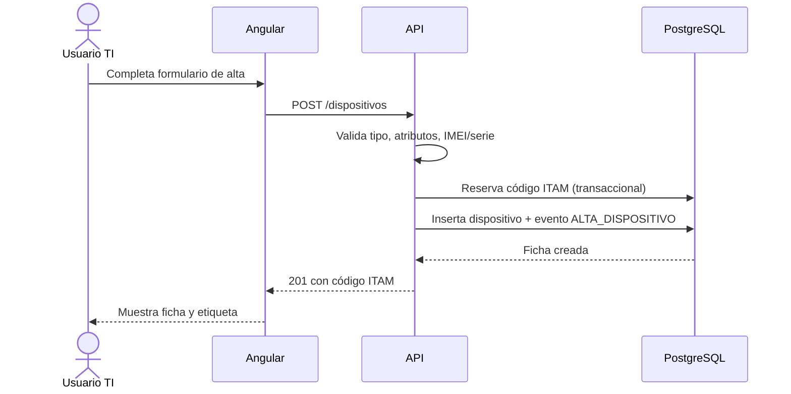

# Flujo de alta de dispositivo

**Actualizado:** 13 de octubre de 2026
**Tipo:** funcional

---

**Referencias cruzadas:**
- [Arquitectura general](../arquitectura/ARQUITECTURA_GENERAL.md)
- [Reglas de negocio](../arquitectura/REGLAS_DE_NEGOCIO.md)
- [Documentación de API](../api/README.md)
