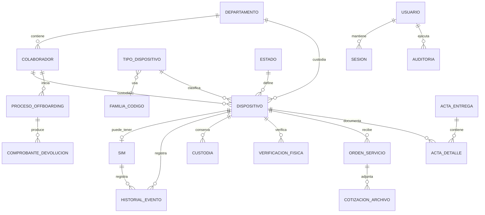

# Modelo de relaciones

**Actualizado:** 23 de septiembre de 2026
**Tipo:** técnico

El diagrama representa relaciones de dominio; los nombres físicos exactos y restricciones se mantienen en `database/migrations`.

## Mapeo con tablas físicas

Algunos nombres son conceptuales. El mapeo real es:

| Entidad del diagrama | Tabla física |
| --- | --- |
| ORDEN_SERVICIO | `itam.ordenes_servicio_tecnico` |
| SESION | `itam.sesiones_usuario` |
| AUDITORIA | `itam.auditoria_operaciones` |
| HISTORIAL_EVENTO | `itam.historial_eventos` |

---

**Referencias cruzadas:**
- [Arquitectura general](../arquitectura/ARQUITECTURA_GENERAL.md)
- [Reglas de negocio](../arquitectura/REGLAS_DE_NEGOCIO.md)
- [Documentación de API](../api/README.md)
