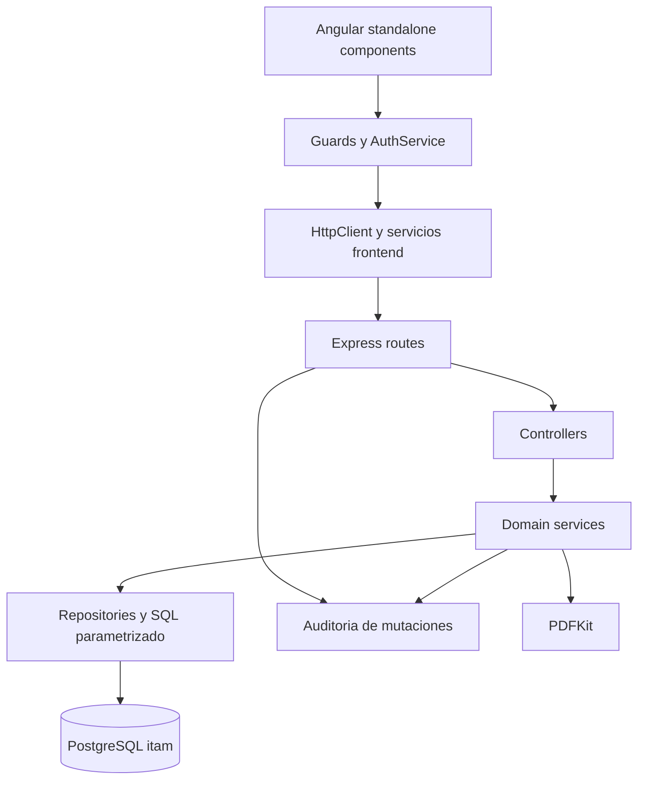

# Arquitectura de la Aplicacion

## Capas

## Backend

`backend/src/app.ts` configura CORS, Helmet, JSON, autenticación, control global de solo lectura y auditoría. Después monta routers por dominio. Los servicios aplican reglas de negocio y los repositorios concentran las consultas. Los errores usan middleware común y respuestas JSON con código HTTP.

## Frontend

Angular usa rutas lazy, componentes standalone, servicios inyectables, formularios reactivos y guards. La vista de servicio técnico mantiene una selección de orden, formularios de edición, diagnóstico y cierre, vista previa PDF y descarga. Las acciones de escritura se ocultan o deshabilitan para `SOLO_LECTURA`, pero la autorización definitiva está en backend.

## Persistencia

PostgreSQL usa el esquema `itam`. Las entidades centrales son usuarios, sesiones, auditoría, departamentos, colaboradores, dispositivos, estados, tipos, familias de códigos, SIM, líneas, historial, órdenes técnicas, cotizaciones, actas, comprobantes, offboarding, verificaciones físicas y metadatos de catálogo técnico. Los binarios de documentos se conservan fuera de PostgreSQL en la ruta persistente configurada.

## Seguridad

- Sesión HTTP-only `itam_session` y token almacenado como hash.
- Expiración absoluta e inactividad con actualización controlada.
- `requireAuth` para API protegida.
- `requireRole("SUPER_USUARIO")` para usuarios y operaciones administrativas específicas.
- `rejectReadOnlyMutations` para bloquear mutaciones globales.
- Helmet y CORS con origen explícito.
- Auditoría posterior a mutaciones.
- Validación de PDF técnico en frontend y backend, con límite de 10 MB, firma `%PDF-` y almacenamiento privado fuera de la base de datos.
- Secretos solo en variables de entorno o secrets de Actions.

## Generación e impresión

Los PDF se generan en backend con PDFKit. Las órdenes de trabajo usan `buildTechnicalOrderPdf` y soportan una orden principal más equipos adicionales. La plantilla conserva A4, logo, tipografía, tablas blancas con bordes gris claro, casillas, firmas, pie y la sección `RECEPCIÓN Y DEVOLUCIÓN (INTERNO)`. La impresión de etiquetas usa `window.print()` desde el navegador.

## Configuración y dependencias externas

| Dependencia | Uso | Estado |
| --- | --- | --- |
| PostgreSQL | Persistencia, metadatos y health check | Confirmado en código; health productivo `200`, consulta SQL directa pendiente |
| Nginx | Proxy HTTPS, frontend estático y límite de carga de 12 MB | Confirmado por CD y smoke test de tamaño; configuración completa pendiente |
| PM2 | Proceso backend en release | Confirmado en CD; estado actual pendiente |
| AWS | Host de despliegue | Confirmado por workflow; región pendiente |
| GitHub Actions | CI/CD | Confirmado |
| DNS y certificados | Acceso público HTTPS | Pendiente de validar en servidor |

## Decisiones y límites

La validación productiva del 13-10-2026 confirmó health API, health de PostgreSQL y CD exitoso del commit `d8cd34c`. El repositorio no demuestra por sí solo backups, restauración, la configuración completa de firewall/TLS ni una carga autenticada de catálogo; esos datos permanecen diferenciados como pendientes.
